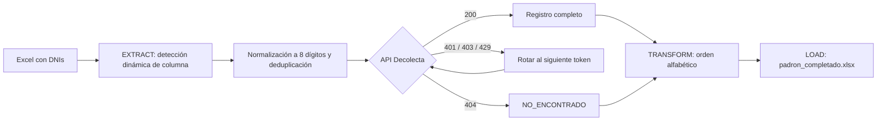

# 🗂️ Padrón ETL — Completado automático de padrones vía DNI

Pipeline ETL en Python que convierte una lista de DNIs en un padrón completo (apellidos y nombres), consultando la API de Decolecta con **rotación automática de tokens** para sortear límites de cuota.

## 🎯 Problema de negocio

Una junta vecinal necesitaba un padrón de asociados, pero solo contaba con un Excel con cientos de DNIs y sin nombres. Completarlo a mano implicaba buscar uno por uno, con alto riesgo de errores y días de trabajo.

**Resultado:** el proceso pasó de ser manual y propenso a errores a una ejecución de un solo comando, con un padrón ordenado alfabéticamente y trazabilidad de cada registro.

| | Antes | Después |
|---|---|---|
| Método | Búsqueda manual, DNI por DNI | Un comando |
| Errores de transcripción | Frecuentes | Ninguno (datos desde la fuente) |
| Orden alfabético | Manual | Automático |
| Registros sin resolver | Se pierden en silencio | Marcados con estado explícito |

## 🏗️ Arquitectura



### Extract
- Lee el Excel con `dtype=str` para preservar ceros a la izquierda.
- **Detección dinámica de la columna DNI**, sin importar su posición ni su nombre (`dni`, `DNI`, `Documento`, `N° DNI`...). Si la cabecera no se reconoce, la infiere por contenido.
- Normaliza a 8 dígitos (`zfill`), descarta valores inválidos y elimina duplicados.

### Transform
- Consulta la API por cada DNI usando una sesión HTTP reutilizable con timeout.
- Estructura apellidos, nombres y nombre completo.
- Ordena alfabéticamente ignorando tildes; los registros no resueltos van al final.

### Load
- Exporta a Excel con una columna `Estado` por registro.
- Si los tokens se agotan, **guarda el avance** y marca el resto como `PENDIENTE`.

## 🔄 Manejo de Rate Limiting con rotación de tokens

Cada token gratuito permite ~100 consultas. El pipeline gestiona esto de forma transparente:

1. Los tokens se cargan desde `.env` y se consumen en orden mediante un `TokenPool`.
2. Ante un `401`, `403` o `429`, se rota al siguiente token y se reintenta **el mismo DNI**, sin perder registros.
3. Errores de red o `5xx` se reintentan con *backoff* exponencial.
4. Cuando no quedan tokens, el script termina de forma controlada, guarda lo procesado y devuelve código de salida `2`.

Con *N* tokens, la capacidad aproximada es *N × 100* consultas por ejecución. Los tokens nunca se escriben en logs.

## 📁 Estructura

```
padron-etl/
├── data/              # Entrada/salida local (ignorada por Git)
├── .env.example       # Plantilla de variables de entorno
├── padron_etl.py      # Pipeline ETL
├── requirements.txt
└── README.md
```

## 🚀 Instalación y uso

**Requisitos:** Python 3.10+ y uno o más tokens de [Decolecta](https://decolecta.com).

```powershell
# 1. Clonar
git clone https://github.com/Rowix69/padron-etl.git
cd padron-etl

# 2. Entorno virtual (Windows PowerShell)
python -m venv .venv
.\.venv\Scripts\Activate.ps1

# 3. Dependencias
pip install -r requirements.txt

# 4. Configurar tokens
Copy-Item .env.example .env
# Edita .env y coloca tus tokens separados por comas

# 5. Colocar el Excel de entrada en data/lista.xlsx y ejecutar
python padron_etl.py
```

En macOS/Linux: `source .venv/bin/activate` y `cp .env.example .env`.

### Opciones

| Argumento | Descripción | Default |
|---|---|---|
| `-i`, `--input` | Excel de entrada | `data/lista.xlsx` |
| `-o`, `--output` | Excel de salida | `data/padron_completado.xlsx` |
| `--hoja` | Nombre o índice de la hoja | `0` |

### Estados en la salida

| Estado | Significado |
|---|---|
| `OK` | Datos obtenidos correctamente |
| `NO_ENCONTRADO` | La API no reconoce el DNI |
| `ERROR_RED` / `ERROR_HTTP_xxx` | Fallo tras reintentos |
| `PENDIENTE` | No se procesó por agotamiento de tokens o interrupción |

## 🔒 Privacidad y seguridad

Este proyecto procesa **datos personales de terceros**. Buenas prácticas aplicadas:

- Los tokens viven solo en `.env`, excluido por `.gitignore`.
- Todo `*.xlsx` y `*.csv` está excluido del repositorio; **nunca subas padrones reales**.
- Los logs enmascaran los DNIs (`12****78`).
- Usa la información solo con el consentimiento y la finalidad legítima que corresponda, conforme a la Ley N.º 29733 de Protección de Datos Personales del Perú.

## ⚠️ Limitaciones

- El Excel debe tener la cabecera en la primera fila.
- La reanudación tras agotar tokens es manual: se vuelve a ejecutar con más tokens.
- Se procesa una consulta a la vez (secuencial) para respetar los límites de la API.

## 🗺️ Roadmap

- [ ] Pruebas unitarias con `pytest` para normalización y detección de columna.
- [ ] Caché/reanudación: omitir DNIs ya resueltos en ejecuciones previas.
- [ ] Respeto del header `Retry-After` antes de rotar token.
- [ ] Empaquetado como CLI instalable (`pyproject.toml`).

## 🛠️ Stack

Python · pandas · requests · python-dotenv · openpyxl

## 👤 Autor

**[Rowix69]** · [GitHub](https://github.com/Rowix69)